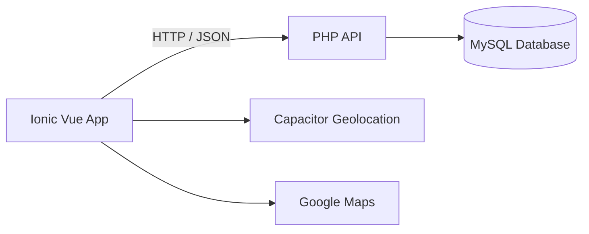

# FindMyVehicle

FindMyVehicle is a mobile parking and vehicle tracking application built as an Applied Computer Science project.

The app helps users remember where they parked a vehicle. Users can manage multiple vehicles, save their current parking location using GPS, add parking details and open the saved location directly in Google Maps.

## Features

- User registration and login
- Manage multiple vehicles
- Start, edit and close parking sessions
- Save the current location using device geolocation
- Add a parking level/zone and description
- Set an optional expiration time
- Open a saved parking location in Google Maps
- View active parkings and parking history
- Store vehicle and parking photos
- REST-style CRUD API for users, vehicles and parkings
- Android support through Capacitor

## Tech stack

### Frontend / Mobile
- Vue 3
- Ionic Vue
- JavaScript
- Capacitor
- Capacitor Geolocation
- Vue Router
- Vite

### Backend
- PHP
- REST-style API
- MySQL / MariaDB
- MySQLi prepared statements

### Testing & tooling
- Cypress
- Vitest
- ESLint
- Git / GitHub

## Architecture



## Project structure

```text
FindMyVehicle/
├── Api/                    # PHP API
│   ├── inc/
│   │   ├── parkings/
│   │   ├── users/
│   │   └── vehicles/
│   └── sql/                # Database schema
├── App/
│   └── findmyvehicle/      # Ionic Vue application
└── Docs/                   # Project documentation
```

## Local setup

### Requirements

- Node.js and npm
- PHP 8+
- Apache, for example through XAMPP
- MySQL or MariaDB

### 1. Clone the repository

```bash
git clone https://github.com/DavidSunmolaOdisee/FindMyVehicle.git
cd FindMyVehicle
```

### 2. Create the database

Create a MySQL database and import:

```text
Api/sql/sql.sql
```

Copy:

```text
Api/inc/dbcon.example.php
```

to:

```text
Api/inc/dbcon.php
```

and update the database credentials.

### 3. Configure the frontend

Inside `App/findmyvehicle`, copy:

```text
.env.example
```

to:

```text
.env
```

Set the URL where the PHP API is hosted:

```env
VITE_API_BASE_URL=http://localhost/FindMyVehicle/Api/
```

### 4. Install and run

```bash
cd App/findmyvehicle
npm install
npm run dev
```

### 5. Build

```bash
npm run build
```

## What I learned

This project gave me practical experience with:

- Building a mobile application with Ionic and Vue
- Connecting a frontend to a PHP API
- CRUD operations and relational databases
- Device geolocation
- Working with asynchronous API calls
- Authentication and password handling
- Structuring a multi-part application
- Git and version control

## Security

New passwords are stored using PHP's password hashing API. Existing legacy accounts are upgraded to hashed passwords after a successful login.

Database credentials and local frontend environment settings are excluded from version control.

## Author

**David Sunmola**  
Applied Computer Science student at Odisee

[LinkedIn](https://www.linkedin.com/in/david-sunmola-b9740243a/)
